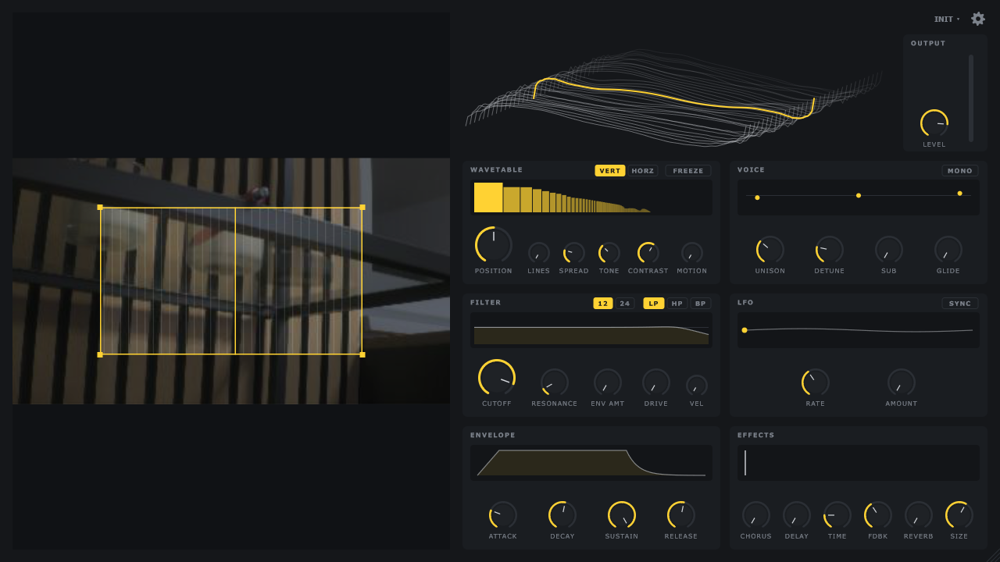

# AxSynth

AxSynth is a wavetable synthesizer (VST3, Windows 64-bit) that plays live images from an Axis network camera. You pick a rectangle in the camera image, and the brightness inside it becomes the wavetable, so the sound changes with whatever the camera sees.



## Install

1. Download `AxSynth-<version>-win64.msi` from [Releases](../../releases).
2. Run it. AxSynth is installed to `C:\Program Files\Common Files\VST3`, where every VST3 host finds it.
3. Rescan plugins in your DAW if it does not show up.

Uninstall via Windows Settings, Apps.

## First use

1. Load AxSynth on an instrument track.
2. Click the gear icon, enter the camera IP, user and password, then click **Verbinden**.
3. Drag a rectangle over the camera image.
4. Play notes.

The connection and the rectangle are saved with your project.

## Build from source

Requires Visual Studio 2022 (C++ workload) and CMake 3.22+.

```
git clone --recurse-submodules https://github.com/Cacsjep/axsynth.git
cd axsynth
scripts\msvc.cmd cmake -S . -B build -G Ninja -DCMAKE_BUILD_TYPE=Release
scripts\msvc.cmd cmake --build build
```

The plugin ends up in `build\AxSynth_artefacts\Release\VST3\AxSynth.vst3`. Releases are built and tested by GitHub Actions (see `.github/workflows`).

## Note on signing

Builds are unsigned unless a code signing certificate is configured for the release workflow. Windows SmartScreen may warn when you run an unsigned installer; choose "More info", then "Run anyway".
